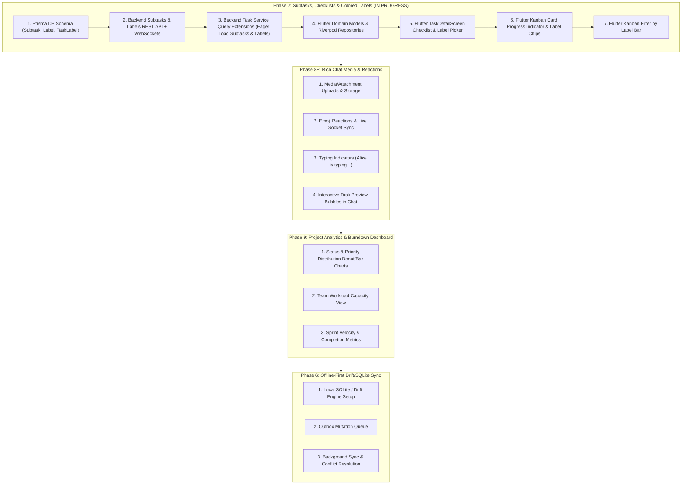

# TeamFlow — Next Features Step-by-Step Implementation Plan

> **Author:** TeamFlow Engineering  
> **Status:** Active Execution  
> **Target Version:** Post-MVP Milestone 2  
> **Scope:** Full-Stack (NestJS Backend + Flutter Mobile/Web Client)

---

## Executive Roadmap

---

## Detailed Step-by-Step Execution Plan for Phase 7 (Subtasks & Labels)

### Step 1: Database Schema Migration (Backend)
- Add `Subtask` model in `schema.prisma`:
  - `id`: UUID Primary Key
  - `taskId`: UUID FK -> Task (Cascade)
  - `title`: String
  - `isCompleted`: Boolean (default `false`)
  - `position`: Float (default `0`)
  - `createdAt`, `updatedAt`
- Add `Label` model in `schema.prisma`:
  - `id`: UUID Primary Key
  - `workspaceId`: UUID FK -> Workspace (Cascade)
  - `name`: String
  - `color`: String (HEX color code, default `#790D16`)
  - Unique constraint on `[workspaceId, name]`
- Add `TaskLabel` pivot model in `schema.prisma`:
  - `taskId`: UUID FK -> Task (Cascade)
  - `labelId`: UUID FK -> Label (Cascade)
  - Composite PK `[taskId, labelId]`
- Link relations on `Task` (`subtasks Subtask[]`, `labels TaskLabel[]`) and `Workspace` (`labels Label[]`).
- Generate Prisma Client: `npm run prisma:generate`.

### Step 2: Backend Subtasks Controller, Service & Socket Events
- **DTOs:**
  - `CreateSubtaskDto`: `title` (required, string), `position` (optional, number).
  - `UpdateSubtaskDto`: `title` (optional, string), `isCompleted` (optional, boolean), `position` (optional, number).
- **Endpoints:**
  - `POST /api/v1/tasks/:taskId/subtasks`: Add subtask to task.
  - `PATCH /api/v1/tasks/:taskId/subtasks/:subtaskId`: Toggle completion, rename, or reorder subtask.
  - `DELETE /api/v1/tasks/:taskId/subtasks/:subtaskId`: Remove subtask.
- **WebSocket Broadcasts:**
  - Broadcast `subtask:created`, `subtask:updated`, `subtask:deleted` to `project:<projectId>`.

### Step 3: Backend Labels Controller, Service & Socket Events
- **DTOs:**
  - `CreateLabelDto`: `name` (required, string), `color` (hex string, e.g. `#790D16`).
- **Endpoints:**
  - `GET /api/v1/workspaces/:workspaceId/labels`: List all workspace labels.
  - `POST /api/v1/workspaces/:workspaceId/labels`: Create new label.
  - `DELETE /api/v1/workspaces/:workspaceId/labels/:labelId`: Delete workspace label.
  - `POST /api/v1/tasks/:taskId/labels/:labelId`: Attach label to task.
  - `DELETE /api/v1/tasks/:taskId/labels/:labelId`: Detach label from task.
- **WebSocket Broadcasts:**
  - Broadcast `task:label_added`, `task:label_removed` to `project:<projectId>`.

### Step 4: Backend Task Queries Enhancement
- Update `tasks.service.ts`:
  - Eager load `subtasks` (ordered by `position asc, createdAt asc`) in `getTaskById` and `getTasks`.
  - Eager load `labels: { include: { label: true } }` in `getTaskById` and `getTasks`.
  - Maintain OCC (`version`) increment on task mutations.

### Step 5: Flutter Domain Models & Data Layer
- Create `SubtaskModel`:
  - `id`, `taskId`, `title`, `isCompleted`, `position`.
  - `copyWith`, `fromJson`, `toJson`.
- Create `LabelModel`:
  - `id`, `workspaceId`, `name`, `color` (parsed as `Color(int.parse(...))`).
  - `copyWith`, `fromJson`, `toJson`.
- Update `TaskModel`:
  - Add `List<SubtaskModel> subtasks` (default empty).
  - Add `List<LabelModel> labels` (default empty).
  - Add computed getters: `totalSubtasks`, `completedSubtasks`, `progressPercentage` (0.0 to 1.0).
- Update `TasksRepository` & `TasksRemoteDataSource`:
  - `addSubtask(taskId, title)`
  - `updateSubtask(taskId, subtaskId, {isCompleted, title})`
  - `deleteSubtask(taskId, subtaskId)`
  - `getWorkspaceLabels(workspaceId)`
  - `createLabel(workspaceId, name, colorHex)`
  - `attachLabel(taskId, labelId)`
  - `detachLabel(taskId, labelId)`

### Step 6: Flutter Task Detail Screen UI
- In `TaskDetailScreen`:
  - **Subtasks Checklist Widget:**
    - Header with subtask count badge and linear progress indicator.
    - Checkbox list tile for each subtask with immediate responsive toggle.
    - Quick "+ Add item" inline text field or dialog.
    - Swipe or tap-to-delete subtask item.
  - **Labels Section:**
    - Horizontal scroll/wrap of colored label pill chips.
    - "+ Add Label" button opening an interactive Label Picker Sheet.
    - Sheet allows picking existing workspace labels or creating a new custom label with color selection.
    - Tap label pill to view/remove.

### Step 7: Flutter Kanban Card & Board Filters
- In `KanbanCard`:
  - Render colored label pill badges on top of task title.
  - Render checklist icon with `completed/total` badge (e.g. `☑ 2/3`) and mini progress line when subtasks exist.
- In `ProjectDetailScreen`:
  - Add horizontal Label Filter bar allowing multi-select filtering of tasks by tag/label.

---

## Execution Progress Tracker

- [x] **Step 1: DB Schema Migration & Prisma Generation**
- [x] **Step 2: Backend Subtasks API & Gateway Broadcasts**
- [x] **Step 3: Backend Labels API & Gateway Broadcasts**
- [x] **Step 4: Backend Task Queries Enrichment**
- [x] **Step 5: Flutter Models & Repository Updates**
- [x] **Step 6: Flutter Task Detail Checklist & Label Picker**
- [x] **Step 7: Flutter Kanban Card & Board Filter Enhancements**
- [x] **Step 8: Verification & End-to-End Testing**
