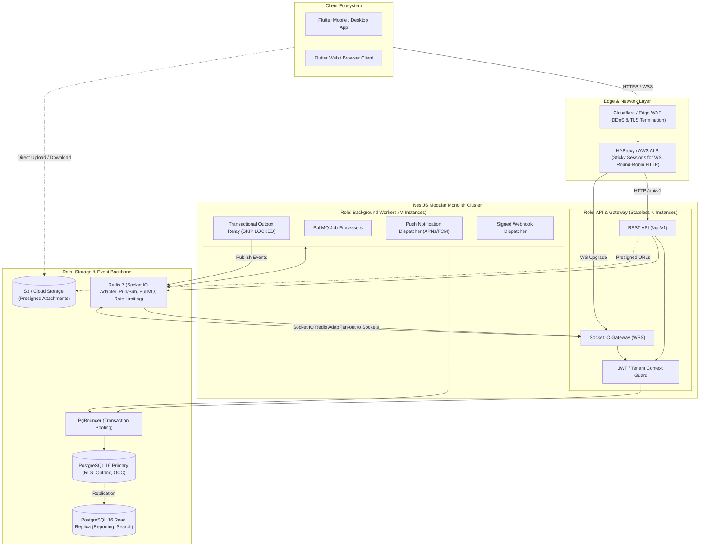
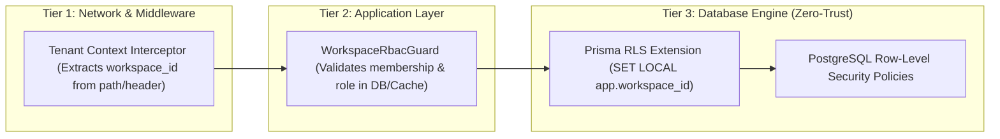
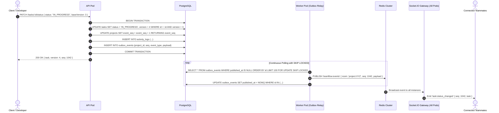
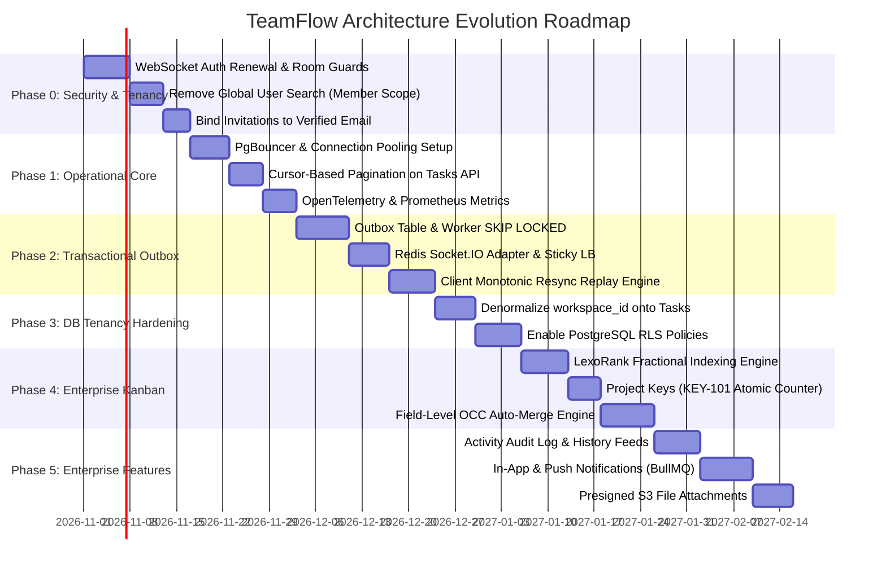

# TeamFlow — Enterprise Scalable System Architecture Specification

> **Document Version:** 2.0.0 (Enterprise Scalability & Distributed Architecture Revision)  
> **Author:** Senior Principal System Design & Distributed Systems Architect (10+ YOE)  
> **Status:** Production-Ready Architectural Blueprint  
> **Target Scale:** 100,000+ DAU | 15,000+ Concurrent WebSockets | Sub-50ms p95 Read Latency | Sub-100ms p95 Mutation Latency  

---

## Table of Contents
1. [Executive Summary & System Vision](#1-executive-summary--system-vision)
2. [Target System Architecture (Modular Monolith with Dual Runtime)](#2-target-system-architecture)
3. [Multi-Tenant Data Architecture & Defense-in-Depth Isolation](#3-multi-tenant-data-architecture--defense-in-depth-isolation)
4. [Event-Driven Real-Time Pipeline & Transactional Outbox](#4-event-driven-real-time-pipeline--transactional-outbox)
5. [Concurrency, OCC & Field-Level Conflict Resolution](#5-concurrency-occ--field-level-conflict-resolution)
6. [Kanban Mechanics: LexoRank Ordering & Human-Readable Keys](#6-kanban-mechanics-lexorank-ordering--human-readable-keys)
7. [Zero-Trust Security, Auth Lifecycle & WebSocket Guarding](#7-zero-trust-security-auth-lifecycle--websocket-guarding)
8. [Database Schema Specification (PostgreSQL 16 + Prisma)](#8-database-schema-specification)
9. [API & WebSocket Event Contracts](#9-api--websocket-event-contracts)
10. [Infrastructure, Connection Pooling & Observability](#10-infrastructure-connection-pooling--observability)
11. [Phased Implementation Roadmap (Phase 0 to Phase 5)](#11-phased-implementation-roadmap)

---

## 1. Executive Summary & System Vision

### 1.1 What is TeamFlow?
**TeamFlow** is an enterprise-grade, high-velocity **Collaborative Project Management & Issue Tracking Platform** (inspired by Linear and Jira), engineered for cross-functional software engineering, product, and design organizations.

### 1.2 Architectural Tenets for High Scale
To support tens of thousands of active teams without degradation, TeamFlow adheres to seven non-negotiable architectural tenets:
1. **Stateless Compute with Dual-Role Deployment**: Single TypeScript/NestJS codebase deployed as two runtime configurations: `api` (HTTP + WebSockets) and `worker` (async outbox processing, BullMQ jobs, and webhooks).
2. **Guaranteed Delivery via Transactional Outbox**: Eliminate dual-write vulnerabilities. Database mutations and domain events commit in the exact same ACID transaction.
3. **Defense-in-Depth Tenant Isolation**: Tenancy is enforced at three independent layers: Application Routing, Global Guards, and PostgreSQL Row-Level Security (RLS) backed by composite foreign keys.
4. **Self-Healing Real-Time Sync**: Clients maintain monotonic sequence counters per project. Any packet loss, socket interruption, or backgrounding triggers an idempotent replay or bulk synchronization.
5. **Optimistic Concurrency Control (OCC) with Field Merging**: Prevent silent data loss while eliminating spurious 409 conflicts through granular field-level diff resolution.
6. **Zero-Cascading Kanban Mechanics**: Column reordering uses **LexoRank string interpolation**, avoiding table-wide position reshuffling.
7. **Zero-Trust WebSocket Lifecycle**: Socket sessions undergo token renewal, granular room join authorization, and instant security revocation fan-out.

---

## 2. Target System Architecture



### Architectural Key Decisions (ADRs)
* **ADR-01: Keep Modular Monolith Over Microservices**: At this scale, network latency between microservices and distributed transactions (Sagas) introduces massive operational complexity. A well-architected modular monolith with clear domain boundaries provides superior developer velocity, sub-millisecond in-process communication, and strict transactionality.
* **ADR-02: Dual Runtime Roles**: The exact same container image is booted with `ROLE=api` or `ROLE=worker`. API pods handle user traffic without being blocked by PDF generation, webhook retries, or batch notifications.
* **ADR-03: PgBouncer in Transaction Mode**: Eliminates PostgreSQL connection exhaustion. Each backend instance maintains a tiny pool (e.g. 5–10 connections) to PgBouncer, which multiplexes thousands of virtual connections into a small pool of database server connections.

---

## 3. Multi-Tenant Data Architecture & Defense-in-Depth Isolation

### 3.1 The 3-Tier Tenancy Isolation Model



### 3.2 Denormalization with Composite Foreign Keys
To guarantee that sub-resources (`tasks`, `comments`, `attachments`, `activity_logs`) can **never** become orphaned or point to a project in a different workspace, `workspace_id` is denormalized onto every tenant-owned table and enforced via composite foreign keys:

```sql
-- Project belongs to Workspace
ALTER TABLE projects ADD CONSTRAINT fk_projects_workspace 
    FOREIGN KEY (workspace_id) REFERENCES workspaces(id) ON DELETE CASCADE;

-- Task belongs to Project AND Workspace (Composite constraint prevents cross-tenant project mapping)
ALTER TABLE tasks ADD CONSTRAINT fk_tasks_project_workspace 
    FOREIGN KEY (project_id, workspace_id) REFERENCES projects(id, workspace_id) ON DELETE CASCADE;

-- Comment belongs to Task AND Workspace
ALTER TABLE comments ADD CONSTRAINT fk_comments_task_workspace 
    FOREIGN KEY (task_id, workspace_id) REFERENCES tasks(id, workspace_id) ON DELETE CASCADE;
```

### 3.3 PostgreSQL Row-Level Security (RLS)
PostgreSQL RLS acts as the absolute fail-safe. Even if an application developer forgets a `where: { workspaceId }` clause in a Prisma query, the database engine filters out rows automatically:

```sql
-- Enable RLS
ALTER TABLE tasks ENABLE ROW LEVEL SECURITY;
ALTER TABLE comments ENABLE ROW LEVEL SECURITY;
ALTER TABLE projects ENABLE ROW LEVEL SECURITY;

-- Dynamic Tenant Isolation Policy
CREATE POLICY task_tenant_isolation ON tasks
    FOR ALL
    USING (workspace_id = NULLIF(current_setting('app.workspace_id', true), '')::uuid);
```

---

## 4. Event-Driven Real-Time Pipeline & Transactional Outbox

### 4.1 Eliminating the Dual-Write Anti-Pattern
In standard architectures, updating the database and emitting a WebSocket event leads to race conditions and silent message drops:
* If the database commit succeeds but the WebSocket server crashes, clients never receive the update.
* If the WebSocket message sends before the database commit fails, clients render phantom state.

### 4.2 The Transactional Outbox Pattern
TeamFlow writes all state mutations and domain events within **one atomic database transaction**:



### 4.3 Self-Healing Reconnect & Sequence Replay Protocol
Every project has a monotonically increasing sequence counter (`event_seq`).
1. **Client Tracking**: The Flutter client records `lastSeq` per active project.
2. **Gap Detection**: If the client receives event `#105` while its local `lastSeq` is `#102`, it detects a gap (e.g. mobile cellular drop).
3. **Resync Catch-up**: The client invokes:
   ```http
   GET /api/v1/projects/:id/events?afterSeq=102&limit=50
   ```
4. **Fallback Full Invalidation**: If the gap exceeds 100 events, the client triggers a full board refetch (`projectTasksProvider.invalidate()`).

---

## 5. Concurrency, OCC & Field-Level Conflict Resolution

### 5.1 Naive OCC vs. Field-Level Smart Merging
* **Naive OCC (Old)**: Modifying a task compares whole-row version (`version = 3`). If Developer A edits the title and Developer B edits the priority simultaneously, Developer B receives a hard `409 Conflict`.
* **Field-Level OCC (Enterprise Architecture)**:
  1. The client sends only modified fields and its `baseVersion`:
     ```json
     {
       "priority": "HIGH",
       "baseVersion": 3
     }
     ```
  2. If `currentVersion == baseVersion`, the write executes directly (`version = baseVersion + 1`).
  3. If `currentVersion > baseVersion`:
     - The server queries `activity_logs` between `baseVersion` and `currentVersion`.
     - **Disjoint Fields (Auto-Merge)**: If Developer A changed `title` while Developer B changed `priority`, the server automatically applies Developer B's edit, increments version to `5`, and returns a clean merge.
     - **Conflicting Fields (Interactive 409)**: If both developers modified `status`, the server returns a structured `409 Conflict` containing the conflicting diff:
       ```json
       {
         "error": {
           "code": "OCC_FIELD_CONFLICT",
           "message": "Status was modified by Alice 5 seconds ago",
           "conflictingFields": ["status"],
           "currentValues": { "status": "IN_REVIEW", "version": 4 },
           "submittedValues": { "status": "DONE", "version": 3 }
         }
       }
       ```

---

## 6. Kanban Mechanics: LexoRank Ordering & Human-Readable Keys

### 6.1 Persistent Card Ordering via Fractional LexoRank
Storing integer positions (`position: 1, 2, 3`) causes **catastrophic database write amplification**: moving card 10 to position 1 in a 5,000-task project requires rewriting 4,999 rows.

TeamFlow implements **LexoRank String Interpolation**:
* Each task has a string `rank` column (e.g. `"0|hzzzzz:"`).
* When dropping a card between `"0|hzzzzz:"` and `"0|i00000:"`, the client or server generates the midpoint: `"0|hzzzzz:8"`.
* **Database Impact**: Only **one single row** is updated during any drag-and-drop operation.
* **Auto-Rebalancing**: If rank strings exceed 64 characters due to repeated midpoints, a background BullMQ job re-indexes ranks evenly across the column.

### 6.2 Atomic Project Keys (`KEY-101`)
1. Every project maintains an atomic integer counter:
   ```sql
   UPDATE projects 
   SET task_counter = task_counter + 1 
   WHERE id = :projectId 
   RETURNING task_counter;
   ```
2. The task is assigned `number = task_counter`.
3. The human-readable key is composite: `${project.key}-${task.number}` (e.g. `FRONT-142`).
4. Unique constraint: `UNIQUE (project_id, number)`.

---

## 7. Zero-Trust Security, Auth Lifecycle & WebSocket Guarding

### 7.1 WebSocket Lifecycle Security (Fixing Handshake Drift)
WebSocket connections cannot rely solely on the initial handshake authentication. TeamFlow enforces three continuous security mechanisms:
1. **Token Expiry Timer**: Upon connection, the gateway calculates milliseconds remaining on the JWT access token and schedules a disconnect timer.
2. **Proactive Renewal (`auth:renew`)**: The Flutter client refreshes its access token at 12 minutes (TTL 15m) and sends:
   ```json
   socket.emit('auth:renew', { accessToken: newJwt });
   ```
   The gateway verifies the fresh token and extends the socket session.
3. **Room Authorization on `join:project`**: A client cannot join arbitrary project rooms. When `join:project { projectId }` is called, the gateway executes `WorkspaceRbacGuard` against Redis permission cache.
4. **Immediate Revocation Fan-out (`security:revoke`)**:
   * If a user is removed from a workspace or a session family is revoked due to theft detection, the worker publishes `security:revoke { userId, workspaceId }` to Redis.
   * All API instances immediately evict that user's sockets from all associated project rooms.

### 7.2 Strict Scoping of User Discovery (Eliminating Platform Enumeration)
* **Global Search Removed**: Platform-wide user search by email is strictly eliminated.
* **Workspace-Scoped Search**: The assignee picker only searches members already enrolled in the active workspace:
  ```http
  GET /api/v1/workspaces/:workspaceId/members?query=alice
  ```
* **Consent-Based External Invitations**: To assign someone outside the workspace, an Admin or Manager issues an invitation. The user is only enrolled after explicitly accepting.
* **Cryptographic Token Hash & Email Binding**:
  * Invitation tokens are generated using `crypto.randomBytes(32)` (256-bit entropy).
  * Only the SHA-256 hash is stored in the database.
  * Acceptance verifies that `invitation.email == currentUser.email` (preventing token theft).
  * Preview tokens are submitted via `POST /api/v1/invitations/preview` in the request body (never in query URLs).

---

## 8. Database Schema Specification

```prisma
// Production PostgreSQL Prisma Schema (v2.0)

generator client {
  provider        = "prisma-client-js"
  previewFeatures = ["relationJoins"]
}

datasource db {
  provider = "postgresql"
  url      = env("DATABASE_URL")
}

enum WorkspaceRole {
  OWNER
  ADMIN
  MANAGER
  MEMBER
}

enum TaskStatus {
  TODO
  IN_PROGRESS
  IN_REVIEW
  DONE
}

enum TaskPriority {
  LOW
  MEDIUM
  HIGH
  URGENT
}

model User {
  id              String            @id @default(uuid()) @db.Uuid
  email           String            @unique
  name            String
  passwordHash    String            @map("password_hash")
  emailVerifiedAt DateTime?         @map("email_verified_at")
  mfaSecret       String?           @map("mfa_secret")
  mfaEnabled      Boolean           @default(false) @map("mfa_enabled")
  createdAt       DateTime          @default(now()) @map("created_at")
  updatedAt       DateTime          @updatedAt @map("updated_at")

  sessions        Session[]
  memberships     WorkspaceMember[]
  assignedTasks   Task[]            @relation("AssignedTasks")
  reportedTasks   Task[]            @relation("ReportedTasks")
  comments        Comment[]
  notifications   Notification[]
  pushTokens      PushToken[]

  @@map("users")
}

model Session {
  id          String    @id @default(uuid()) @db.Uuid
  userId      String    @map("user_id") @db.Uuid
  refreshHash String    @map("refresh_hash")
  familyId    String    @map("family_id")
  ipAddress   String?   @map("ip_address")
  userAgent   String?   @map("user_agent")
  expiresAt   DateTime  @map("expires_at")
  revokedAt   DateTime? @map("revoked_at")
  lastUsedAt  DateTime  @default(now()) @map("last_used_at")
  createdAt   DateTime  @default(now()) @map("created_at")

  user        User      @relation(fields: [userId], references: [id], onDelete: Cascade)

  @@index([familyId])
  @@index([userId])
  @@map("sessions")
}

model Workspace {
  id          String            @id @default(uuid()) @db.Uuid
  name        String
  slug        String            @unique
  archivedAt  DateTime?         @map("archived_at")
  createdAt   DateTime          @default(now()) @map("created_at")
  updatedAt   DateTime          @updatedAt @map("updated_at")

  members     WorkspaceMember[]
  projects    Project[]
  tasks       Task[]
  comments    Comment[]
  invitations Invitation[]
  activity    ActivityLog[]
  outbox      OutboxEvent[]

  @@map("workspaces")
}

model WorkspaceMember {
  workspaceId String        @map("workspace_id") @db.Uuid
  userId      String        @map("user_id") @db.Uuid
  role        WorkspaceRole @default(MEMBER)
  joinedAt    DateTime      @default(now()) @map("joined_at")

  workspace   Workspace     @relation(fields: [workspaceId], references: [id], onDelete: Cascade)
  user        User          @relation(fields: [userId], references: [id], onDelete: Cascade)

  @@id([workspaceId, userId])
  @@index([userId])
  @@map("workspace_members")
}

model Project {
  id          String        @id @default(uuid()) @db.Uuid
  workspaceId String        @map("workspace_id") @db.Uuid
  name        String
  key         String        // e.g. "FRONT", "API"
  description String?
  taskCounter Int           @default(0) @map("task_counter")
  eventSeq    BigInt        @default(0) @map("event_seq")
  archivedAt  DateTime?     @map("archived_at")
  createdAt   DateTime      @default(now()) @map("created_at")
  updatedAt   DateTime      @updatedAt @map("updated_at")

  workspace   Workspace     @relation(fields: [workspaceId], references: [id], onDelete: Cascade)
  tasks       Task[]

  @@unique([workspaceId, key])
  @@unique([id, workspaceId]) // Enables composite foreign key
  @@index([workspaceId])
  @@map("projects")
}

model Task {
  id          String        @id @default(uuid()) @db.Uuid
  workspaceId String        @map("workspace_id") @db.Uuid
  projectId   String        @map("project_id") @db.Uuid
  number      Int           // Human-readable: Project.key + "-" + number
  title       String
  description String?
  status      TaskStatus    @default(TODO)
  priority    TaskPriority  @default(MEDIUM)
  rank        String        // LexoRank string for drag & drop
  version     Int           @default(1) // Atomic OCC version
  reporterId  String        @map("reporter_id") @db.Uuid
  assigneeId  String?       @map("assignee_id") @db.Uuid
  dueAt       DateTime?     @map("due_at")
  deletedAt   DateTime?     @map("deleted_at")
  createdAt   DateTime      @default(now()) @map("created_at")
  updatedAt   DateTime      @updatedAt @map("updated_at")

  workspace   Workspace     @relation(fields: [workspaceId], references: [id], onDelete: Cascade)
  project     Project       @relation(fields: [projectId, workspaceId], references: [id, workspaceId], onDelete: Cascade)
  reporter    User          @relation("ReportedTasks", fields: [reporterId], references: [id])
  assignee    User?         @relation("AssignedTasks", fields: [assigneeId], references: [id])
  comments    Comment[]
  attachments Attachment[]

  @@unique([projectId, number])
  @@unique([id, workspaceId]) // Enables composite foreign key for sub-resources
  @@index([workspaceId])
  @@index([projectId, status, rank])
  @@index([assigneeId])
  @@map("tasks")
}

model Comment {
  id          String        @id @default(uuid()) @db.Uuid
  workspaceId String        @map("workspace_id") @db.Uuid
  taskId      String        @map("task_id") @db.Uuid
  authorId    String        @map("author_id") @db.Uuid
  content     String
  deletedAt   DateTime?     @map("deleted_at")
  createdAt   DateTime      @default(now()) @map("created_at")
  updatedAt   DateTime      @updatedAt @map("updated_at")

  workspace   Workspace     @relation(fields: [workspaceId], references: [id], onDelete: Cascade)
  task        Task          @relation(fields: [taskId, workspaceId], references: [id, workspaceId], onDelete: Cascade)
  author      User          @relation(fields: [authorId], references: [id])

  @@index([taskId, createdAt])
  @@map("comments")
}

model OutboxEvent {
  id          BigInt        @id @default(autoincrement())
  workspaceId String        @map("workspace_id") @db.Uuid
  projectId   String        @map("project_id") @db.Uuid
  seq         BigInt        // Project monotonic sequence counter
  eventType   String        @map("event_type")
  payload     Json
  publishedAt DateTime?     @map("published_at")
  createdAt   DateTime      @default(now()) @map("created_at")

  workspace   Workspace     @relation(fields: [workspaceId], references: [id], onDelete: Cascade)

  @@index([publishedAt, id])
  @@index([projectId, seq])
  @@map("outbox_events")
}

model ActivityLog {
  id          String        @id @default(uuid()) @db.Uuid
  workspaceId String        @map("workspace_id") @db.Uuid
  actorId     String        @map("actor_id") @db.Uuid
  entityType  String        @map("entity_type") // TASK, PROJECT, WORKSPACE
  entityId    String        @map("entity_id") @db.Uuid
  action      String        // STATUS_CHANGED, TITLE_UPDATED, REASSIGNED
  changes     Json          // { "status": { "old": "TODO", "new": "IN_PROGRESS" } }
  version     Int           @map("version")
  createdAt   DateTime      @default(now()) @map("created_at")

  workspace   Workspace     @relation(fields: [workspaceId], references: [id], onDelete: Cascade)

  @@index([entityId, version])
  @@index([workspaceId, createdAt])
  @@map("activity_logs")
}

model Invitation {
  id          String        @id @default(uuid()) @db.Uuid
  workspaceId String        @map("workspace_id") @db.Uuid
  email       String
  role        WorkspaceRole @default(MEMBER)
  tokenHash   String        @unique @map("token_hash")
  invitedBy   String        @map("invited_by") @db.Uuid
  expiresAt   DateTime      @map("expires_at")
  acceptedAt  DateTime?     @map("accepted_at")
  revokedAt   DateTime?     @map("revoked_at")
  createdAt   DateTime      @default(now()) @map("created_at")

  workspace   Workspace     @relation(fields: [workspaceId], references: [id], onDelete: Cascade)

  @@index([workspaceId, email])
  @@map("invitations")
}

model Attachment {
  id          String        @id @default(uuid()) @db.Uuid
  workspaceId String        @map("workspace_id") @db.Uuid
  taskId      String        @map("task_id") @db.Uuid
  uploaderId  String        @map("uploader_id") @db.Uuid
  fileName    String        @map("file_name")
  fileSize    Int           @map("file_size")
  mimeType    String        @map("mime_type")
  storageKey  String        @map("storage_key")
  createdAt   DateTime      @default(now()) @map("created_at")

  task        Task          @relation(fields: [taskId, workspaceId], references: [id, workspaceId], onDelete: Cascade)

  @@index([taskId])
  @@map("attachments")
}

model Notification {
  id          String        @id @default(uuid()) @db.Uuid
  userId      String        @map("user_id") @db.Uuid
  workspaceId String        @map("workspace_id") @db.Uuid
  type        String        // TASK_ASSIGNED, MENTIONED, STATUS_CHANGED
  title       String
  body        String
  payload     Json
  readAt      DateTime?     @map("read_at")
  createdAt   DateTime      @default(now()) @map("created_at")

  user        User          @relation(fields: [userId], references: [id], onDelete: Cascade)

  @@index([userId, readAt, createdAt])
  @@map("notifications")
}

model PushToken {
  id          String        @id @default(uuid()) @db.Uuid
  userId      String        @map("user_id") @db.Uuid
  token       String        @unique
  platform    String        // ANDROID, IOS, WEB
  updatedAt   DateTime      @updatedAt @map("updated_at")

  user        User          @relation(fields: [userId], references: [id], onDelete: Cascade)

  @@map("push_tokens")
}
```

---

## 9. API & WebSocket Event Contracts

### 9.1 REST Endpoints (RFC 7807 Standardized)

#### Authentication & Sessions
* `POST /api/v1/auth/register` — Register new user identity.
* `POST /api/v1/auth/login` — Authenticate and issue rotating token pair.
* `POST /api/v1/auth/refresh` — Single-flight refresh token rotation with 30s grace window.
* `POST /api/v1/auth/logout` — Revoke active session family.
* `GET  /api/v1/me/sessions` — List active sessions (device, IP, last used).
* `DELETE /api/v1/me/sessions/:id` — Revoke a specific remote session.

#### Workspaces & Members
* `GET  /api/v1/workspaces` — List workspaces where user is an active member.
* `POST /api/v1/workspaces` — Create workspace (assigns `OWNER` role).
* `GET  /api/v1/workspaces/:id` — Fetch workspace details and user role.
* `GET  /api/v1/workspaces/:id/members?query=` — Search members within workspace.
* `PATCH /api/v1/workspaces/:id/members/:userId` — Change member role (`OWNER` only).
* `DELETE /api/v1/workspaces/:id/members/:userId` — Remove member (`OWNER` only).

#### Invitations (Consent-Based)
* `POST /api/v1/workspaces/:id/invitations` — Generate invitation token (`ADMIN` / `OWNER`).
* `POST /api/v1/invitations/preview` — Inspect invitation details (token in body).
* `POST /api/v1/invitations/accept` — Accept invitation (enforces email match).
* `DELETE /api/v1/workspaces/:id/invitations/:invitationId` — Revoke invitation.

#### Projects & Tasks (OCC & LexoRank)
* `GET  /api/v1/workspaces/:id/projects` — List projects with metrics.
* `POST /api/v1/workspaces/:id/projects` — Create project with unique key.
* `GET  /api/v1/projects/:id/tasks?cursor=&limit=50&status=` — Keyset-paginated tasks.
* `POST /api/v1/projects/:id/tasks` — Create task (atomic counter + LexoRank).
* `PATCH /api/v1/tasks/:id` — Update fields with field-level OCC check.
* `PATCH /api/v1/tasks/:id/position` — Reorder task within Kanban column (updates `rank`).
* `GET  /api/v1/projects/:id/events?afterSeq=&limit=50` — Resync gap catch-up.

### 9.2 Real-Time WebSocket Event Contract

| Event Name | Direction | Payload Structure | Architectural Function |
| :--- | :---: | :--- | :--- |
| `join:project` | Client ➔ Server | `{ projectId: UUID }` | RBAC-validated room subscription. |
| `leave:project` | Client ➔ Server | `{ projectId: UUID }` | Clean room unsubscribe. |
| `auth:renew` | Client ➔ Server | `{ accessToken: string }` | Mid-session socket credential extension. |
| `task:created` | Server ➔ Room | `{ seq, task, version }` | Inserts new task at top of column. |
| `task:updated` | Server ➔ Room | `{ seq, taskId, changes, version }` | Updates task fields; triggers auto-merge. |
| `task:status_changed` | Server ➔ Room | `{ seq, taskId, fromStatus, toStatus, rank, version }` | Moves Kanban card smoothly. |
| `task:deleted` | Server ➔ Room | `{ seq, taskId }` | Removes card from board view. |
| `resync:required` | Server ➔ Client | `{ projectId, latestSeq }` | Alerts client that gap exceeds threshold. |
| `security:revoke` | Server ➔ User | `{ workspaceId, reason }` | Instant room eviction upon role change. |

---

## 10. Infrastructure, Connection Pooling & Observability

### 10.1 Connection Pooling Topology
* **PostgreSQL Server**: Configured for `max_connections = 200`.
* **PgBouncer Instance**: Configured in **transaction pooling mode** (`pool_mode = transaction`).
  * Handles up to 10,000 incoming client connections.
  * Directs active transactions into a pooled connection set of 30–50 backend connections.
  * Supports `SET LOCAL app.workspace_id` because `SET LOCAL` is strictly transaction-scoped and resets upon `COMMIT` / `ROLLBACK`.

### 10.2 Observability & Telemetry Standard
1. **W3C Trace Context (`traceparent`)**: Generated at Edge/ALB, propagated across HTTP requests, PostgreSQL queries via `/* traceparent */` SQL comments, and WebSocket event payloads.
2. **Prometheus Metrics**:
   * `teamflow_http_request_duration_seconds` (p50, p95, p99).
   * `teamflow_occ_conflicts_total` (Tracks rate of 409 responses).
   * `teamflow_websocket_active_connections` (Gauge per API pod).
   * `teamflow_outbox_lag_seconds` (Difference between `now()` and oldest unpublished event).
   * `teamflow_pgbouncer_active_clients` & `pooled_connections`.

---

## 11. Phased Implementation Roadmap



### Phase Summary Matrix

| Phase | Core Objective | Primary Deliverables | Status | Failure Risk if Omitted |
| :--- | :--- | :--- | :--- | :--- |
| **Phase 0** | **Critical Security & Tenancy** | Socket auth lifecycle (`auth:renew`, disconnect timers, private `user:${id}` rooms), member-scoped assignee search, `POST /invitations/preview`, strict invitation email binding | **COMPLETED & VERIFIED** (44 backend tests, 24 frontend tests passing) | Cross-tenant data leaks & user enumeration |
| **Phase 1** | **Operational Foundation** | PgBouncer pooling, cursor pagination, OpenTelemetry tracing | Planned | Database connection exhaustion at spike loads |
| **Phase 2** | **Event Reliability & Scaling** | Transactional Outbox, Redis adapter, Sequence gap recovery | Planned | Lost board updates on mobile network drops |
| **Phase 3** | **Zero-Trust Tenancy** | Composite FKs, denormalized `workspace_id`, PostgreSQL RLS | Planned | Accidental leakage from a single missed guard |
| **Phase 4** | **High-Scale Kanban UX** | LexoRank card drag & drop, `KEY-101` counters, field OCC merge | Planned | Cascading DB updates & constant user 409 errors |
| **Phase 5** | **Enterprise Collaboration** | Activity logs, BullMQ push notifications, S3 presigned attachments | Planned | Inability to scale to large enterprise teams |
