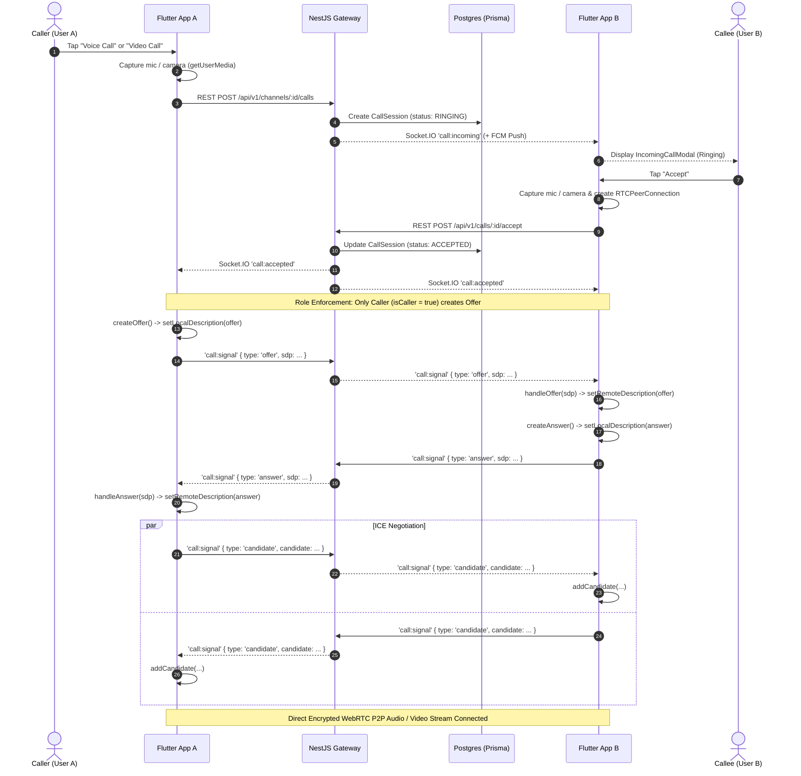

# TeamFlow Voice & Video Calling Architecture

## 1. Overview
The Voice and Video Calling feature in TeamFlow provides real-time, peer-to-peer (P2P), encrypted audio and video communication between workspace teammates in both Direct Messages and Channels.

---

## 2. Technology Stack

### Frontend (Flutter)
- **`flutter_webrtc: ^1.6.3`**: Google libwebrtc C++ native bindings for mobile audio/video capture, peer connection management, codec negotiation, and rendering.
- **`permission_handler: ^11.3.1`**: Dynamic OS runtime permission requests (`RECORD_AUDIO`, `CAMERA`).
- **`flutter_riverpod: ^2.6.1`**: Reactive state management coordinating call lifecycle (`CallNotifier`, `CallState`).
- **`socket_io_client: ^3.1.6`**: Low-latency bi-directional signaling channel for SDP offers/answers and ICE candidate exchange.
- **`firebase_messaging: ^17.0.1`**: Background call notification wake-up service.

### Backend (NestJS)
- **`@nestjs/websockets` / `Socket.IO`**: Real-time event gateway for call routing.
- **Prisma ORM & PostgreSQL**: `CallSession` audit persistence and call history.
- **`firebase-admin`**: Priority data push notification dispatch.

---

## 3. End-to-End Signaling & Media Flow



---

## 4. Key Architectural Components

### A. WebRTC Media Service (`lib/core/webrtc/webrtc_service.dart`)
- **Microphone & Camera Acquisition**:
  ```dart
  final mediaConstraints = <String, dynamic>{
    'audio': true,
    'video': isVideo ? { ... } : false,
  };
  _localStream = await navigator.mediaDevices.getUserMedia(mediaConstraints);
  ```
- **STUN Server Configuration**: Uses Google STUN servers (`stun.l.google.com:19302`) with `unified-plan` SDP semantics.
- **Queued Candidate Buffering**: Buffers remote ICE candidates arriving before the remote SDP description is set, preventing `RTCSessionDescription must be set before adding candidates` errors.
- **Hardware Audio Output Routing**: Uses `Helper.setSpeakerphoneOn(isSpeakerOn)` for direct Android/iOS `AudioManager` routing between loudspeaker and earpiece.

### B. State Management (`lib/features/chat/presentation/providers/call_providers.dart`)
- **Offer-Answer Glare Prevention**:
  `CallState` tracks `isCaller`. When `call:accepted` triggers across the channel room, **only the initiator (`isCaller == true`)** creates and broadcasts the SDP offer. The callee waits for the incoming offer, preventing `Called in wrong state: have-local-offer` collisions.
- **Self-Signal Filtering**:
  Incoming `call:signal` events inspect `senderId` against `currentUserId` to prevent processing self-echoed messages.
- **Resource Disposal**:
  When a call is terminated or rejected, `dispose()` stops all tracks, tears down the `RTCPeerConnection`, and flushes candidate buffers.

### C. Presentation Screens & Widgets
- **`VoiceCallScreen`**: Displays animated avatar ripple wave, mute toggle, speakerphone toggle, and one-tap video upgrade.
- **`VideoCallScreen`**: Renders remote video with `RTCVideoView` and local camera in a floating Picture-in-Picture (PiP) window.
- **`IncomingCallModal`**: Global ringing overlay prompting the user to accept or reject incoming calls.

---

## 5. Native Permissions Configuration

### Android (`android/app/src/main/AndroidManifest.xml`)
```xml
<uses-permission android:name="android.permission.RECORD_AUDIO" />
<uses-permission android:name="android.permission.CAMERA" />
<uses-permission android:name="android.permission.MODIFY_AUDIO_SETTINGS" />
<uses-permission android:name="android.permission.BLUETOOTH" />
<uses-permission android:name="android.permission.BLUETOOTH_CONNECT" />
<uses-feature android:name="android.hardware.microphone" android:required="false" />
<uses-feature android:name="android.hardware.camera" android:required="false" />
```

### iOS (`ios/Runner/Info.plist`)
```xml
<key>NSMicrophoneUsageDescription</key>
<string>TeamFlow requires microphone access for voice and video calls.</string>
<key>NSCameraUsageDescription</key>
<string>TeamFlow requires camera access for video calls.</string>
```

---

## 6. Socket.IO Signaling Events

| Event Name | Direction | Payload | Description |
| :--- | :--- | :--- | :--- |
| `call:incoming` | Server -> Client | `{ callId, channelId, callerId, callerName, type }` | Notifies recipient of an incoming call |
| `call:accepted` | Server -> Client | `{ callId, channelId, responderId, responderName }` | Triggers caller to create SDP offer |
| `call:rejected` | Server -> Client | `{ callId, reason }` | Informs caller that call was rejected |
| `call:ended` | Server -> Client | `{ callId, channelId, endedBy, durationSeconds }` | Disposes media session on both sides |
| `call:signal` | Bidirectional | `{ callId, targetUserId?, channelId?, signal: { type, sdp/candidate } }` | Transfers SDP offer, answer, or ICE candidates |

---

## 7. Testing & Verification
- Unit test suite: `test/features/chat/call_webrtc_test.dart` (covers hardware toggles, WebRTC lifecycle, and role management).
- Build verification: Tested via `./gradlew assembleDebug` (compile and build pass with Gradle 8.14 and AGP 8.11).
