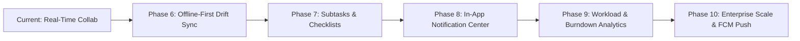

# TeamFlow — Future Features Roadmap & Technical Specifications

> **Target Horizon:** Post-MVP Production Enhancements  
> **Status:** Planned & Prioritized  
> **Architecture Principle:** Layered additions building on existing multi-tenant and real-time foundations without breaking API contracts.

---

## 1. Roadmap Overview



---

## 2. Phase 6: Offline-First Local Drift/SQLite Sync & Outbox Queue

### 2.1 Problem Statement
Field engineers and mobile users frequently encounter network drops (subways, travel, spotty WiFi). Users must be able to read workspaces, projects, and Kanban cards instantly from disk, create or move tasks offline, and have those mutations automatically reconcile when connectivity returns.

### 2.2 Architecture & Pattern
- **Local Database:** `drift` + `sqlite3_flutter_libs` in Flutter.
- **Outbox Pattern:**
  - When offline, mutations (`CREATE_TASK`, `TRANSITION_STATUS`, `EDIT_TASK`, `POST_COMMENT`) are recorded in a local `pending_mutations` table.
  - The UI updates optimistically against the local Drift cache immediately.
- **Sync Engine:**
  - Monitors connectivity using `connectivity_plus`.
  - When connection is restored, flushes pending mutations in chronological order using HTTP REST with version check.
  - On version mismatch (`409 Conflict`), pulls latest server state and prompts user with a conflict resolution dialog.

### 2.3 Proposed Drift Schema
```dart
class LocalTasks extends Table {
  TextColumn get id => text()();
  TextColumn get projectId => text()();
  TextColumn get title => text()();
  TextColumn get description => text().nullable()();
  TextColumn get status => text()();
  TextColumn get priority => text()();
  IntColumn get version => integer()();
  IntColumn get position => integer()();
  BoolColumn get isSynced => boolean().withDefault(const Constant(true))();
  DateTimeColumn get updatedAt => dateTime()();

  @override
  Set<Column> get primaryKey => {id};
}

class PendingMutations extends Table {
  IntColumn get id => integer().autoIncrement()();
  TextColumn get entityType => text()(); // 'TASK', 'COMMENT'
  TextColumn get entityId => text()();
  TextColumn get action => text()(); // 'CREATE', 'UPDATE', 'DELETE', 'STATUS'
  TextColumn get payloadJson => text()();
  DateTimeColumn get createdAt => dateTime()();
}
```

---

## 3. Phase 7: Subtasks, Labels, Colored Tags & Checklists

### 3.1 Overview
Tasks often encompass multi-step requirements that do not warrant a separate parent task. Subtasks with checklists and categorized labels significantly improve team clarity.

### 3.2 Key Capabilities
- **Subtasks & Checklists:**
  - Add, check/uncheck, rename, and delete subtasks inside `TaskDetailScreen`.
  - Progress bar on Kanban cards (e.g., `3/5 done • 60%`).
  - Auto-advance task to `DONE` when all subtasks are checked (optional toggle).
- **Labels & Tags:**
  - Workspace-wide or project-wide labels with customizable HEX color pills (e.g., `Frontend`, `Bug`, `Security`, `Backend`).
  - Multi-select label filtering in Kanban Board view.

### 3.3 Proposed Prisma Schema Extensions
```prisma
model Subtask {
  id          String    @id @default(uuid())
  taskId      String
  task        Task      @relation(fields: [taskId], references: [id], onDelete: Cascade)
  title       String
  isCompleted Boolean   @default(false)
  position    Int       @default(0)
  createdAt   DateTime  @default(now())
  updatedAt   DateTime  @updatedAt

  @@index([taskId])
}

model Label {
  id          String      @id @default(uuid())
  workspaceId String
  workspace   Workspace   @relation(fields: [workspaceId], references: [id], onDelete: Cascade)
  name        String
  color       String      @default("#790D16") // Hex color
  tasks       TaskLabel[]

  @@unique([workspaceId, name])
}

model TaskLabel {
  taskId  String
  labelId String
  task    Task  @relation(fields: [taskId], references: [id], onDelete: Cascade)
  label   Label @relation(fields: [labelId], references: [id], onDelete: Cascade)

  @@id([taskId, labelId])
}
```

---

## 4. Phase 8: In-App Notification Center & Activity Feed

### 4.1 Overview
Keep collaborators informed in real time when work is assigned, mentioned, or completed.

### 4.2 Key Capabilities
- **Notification Types:**
  - `TASK_ASSIGNED`: User was assigned to a task.
  - `COMMENT_MENTION`: User `@mentioned` in a task comment.
  - `STATUS_CHANGED`: A watched or created task changed columns.
  - `INVITATION_RECEIVED`: Invited to join a workspace.
- **Client Experience:**
  - Bell icon in the AppBar with unread count badge.
  - Sliding Notification Drawer with "Mark All as Read" action.
  - Tapping a notification navigates directly to the target project or task.
- **Real-Time Delivery:**
  - WebSocket event `notification:created` emitted directly to `user:<userId>` room.

---

## 5. Phase 9: Project Analytics, Burndown & Workload Dashboard

### 5.1 Overview
Provide engineering leads and managers with visual clarity into sprint velocity, bottlenecks, and team bandwidth.

### 5.2 Key Capabilities
- **Status Distribution:** Donut chart showing distribution across `TODO`, `IN_PROGRESS`, `IN_REVIEW`, and `DONE`.
- **Priority Matrix:** Bar chart illustrating open bugs/features by severity tier.
- **Member Capacity:** Horizontal workload breakdown showing number of active tasks per team member.
- **Velocity / Burndown:** Cumulative flow diagram showing completion speed over time.
- **Exporting:** One-click CSV and JSON report generation.

---

## 6. Phase 10: Enterprise Scalability & Infrastructure

### 6.1 Redis Distributed Pub/Sub & Caching
- **Socket.IO Redis Adapter (`@socket.io/redis-adapter`):**
  - Enables multiple NestJS API server instances behind a load balancer without dropping WebSocket connections.
- **Redis Response Cache:**
  - Cache high-frequency workspace and project metadata queries with cache invalidation on mutations.

### 6.2 Push Notifications via Firebase Cloud Messaging (FCM)
- Mobile push notifications when the application is backgrounded or killed.
- Device registration token endpoint (`POST /api/v1/devices/token`).

### 6.3 Automated CI/CD & Docker Production Compose
- Automated GitHub Actions workflow testing both Flutter app and NestJS API on pull request.
- Multi-stage Dockerfile for NestJS API with Alpine Linux base.
- Production environment variables hardening and secrets rotation guide.
